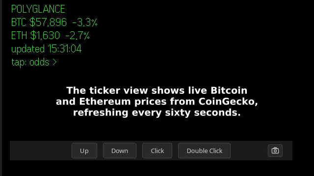
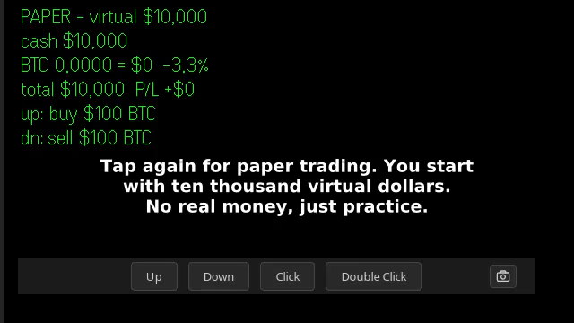
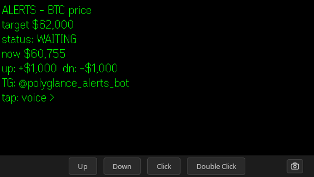

# PolyGlance

A smart-glasses app for the Even Realities G2 that lets crypto holders check
prices, prediction-market odds, a virtual portfolio, and price alerts at a
glance — with **voice commands** and **Telegram alerts** that keep working
when the glasses app is closed — built for the **Heads Up: Even Realities
Hackathon** (track: **Crypto & DeFi**), solo by
[@ilham270207](https://github.com/ilham270207).

> **Data only — not financial advice. Virtual money, no real funds.**

## What it does

One page, one full-screen text container (576×288, green monochrome).
**Tap** switches views, **double-tap** exits, **swipe up/down** acts per view.

| View | Content | Swipe up / down |
| --- | --- | --- |
| **TICKER** | BTC + ETH price (CoinGecko) and 24h change, auto-refresh every 60s | Manual refresh |
| **ODDS** | Top 3 crypto markets on Polymarket (YES % by 24h volume), each shown as a short distinct label like `BTC dip $55,000? YES 38%` | Previous / next page of markets |
| **PAPER-BTC** | Virtual $10,000 portfolio: cash, BTC holding, total, P/L | Buy $100 BTC / sell $100 BTC |
| **PAPER-ETH** | Same shared cash, ETH holding, total, P/L | Buy $100 ETH / sell $100 ETH |
| **ALERTS** | BTC price alert: target + status (WAITING / `BTC HIT $X!`); Telegram bot row `@polyglance_alerts_bot` | Target +$1,000 / -$1,000 |
| **VOICE** | Push-to-talk voice commands via Groq Whisper (e.g. `buy 100 bitcoin`, `set alert 58000`, `show odds`); live mic level meter | Start/stop listening / cancel |

- Paper trades are stored in `localStorage` (`polyglance.paper.v2`, migrated
  from v1 `{cash, btc}` with ETH starting at 0), so the portfolio survives
  restarts. Cash is shared between the BTC and ETH views; total = cash + BTC
  value + ETH value. Selling requires a holding worth at least $100,
  otherwise the glasses show `NOT ENOUGH BTC` / `NOT ENOUGH ETH` for
  3 seconds.
- The price alert arms automatically once a target is set (default: the next
  whole $1,000 above the current BTC price). When BTC reaches the target the
  glasses show `BTC HIT $X!` and jump to the ALERTS view. Target and status
  are stored in `localStorage` (`polyglance.alert.v1`).
- If a fetch fails, the app keeps showing the last data with an
  `OFFLINE - last data` line instead of going blank.
- All on-glasses text is plain ASCII (max 8 lines, 34 chars per line).

## Voice + Telegram (v5)

- **Voice commands (VOICE view):** push-to-talk on the glasses mic
  (`g2-microphone` permission). Audio is transcribed with Groq Whisper
  (`whisper-large-v3-turbo`) and run through a local command parser
  (`src/voice.ts`, 40/40 unit tests) — the same parser the settings-page
  command chips use, so commands are testable without speaking. Without a
  Groq key the view explains how to set one.
- **Your key stays on your phone:** the Groq API key is entered in the
  companion settings page and stored in `localStorage` only — it is never
  sent anywhere except `api.groq.com` for transcription. If the direct
  Groq call fails or times out, the app falls back to your own Cloudflare
  Worker STT proxy (`POST /stt`, URL also set in settings); the proxy holds
  its own key as a Worker secret, so the glasses never need a direct
  connection to Groq.
- **Telegram alerts:** a Cloudflare Worker watcher (`watcher/`, cron every
  minute) polls prices and runs the bot **@polyglance_alerts_bot**:
  `/alert btc above 58000`, `/price`, `/odds`, `/list`, `/remove 1`,
  `/health`, `/help`. Alerts fire once per crossing and keep working even
  when the glasses app is closed. The bot token is a Worker secret only —
  never in this repo. Price source is CoinGecko with a Coinbase spot
  fallback (CoinGecko returns 403 to Workers); see
  `watcher/README.md` for deploy steps.

## Screenshots

Glasses display (576×288), captured in the Even Hub simulator.



*TICKER — live BTC + ETH prices from CoinGecko, auto-refresh every 60 seconds.*


*ODDS — top crypto markets on Polymarket with live YES %, each with a short distinct label (v5).*



*PAPER — virtual $10,000 portfolio, buy/sell $100 per swipe.*


*VOICE — push-to-talk voice commands via Groq Whisper (`buy 100 bitcoin`, `set alert 58000`, `show odds`).*



*ALERTS — BTC price alert (target $62,000, WAITING) with the Telegram bot row (`@polyglance_alerts_bot`).*

## Demo

▶️ [Watch the 86-second demo on YouTube](https://www.youtube.com/watch?v=7jwChwKZxKQ) — "PolyGlance — Crypto at a Glance on Even Realities G2 (Voice + Telegram)": TICKER, ODDS, paper trading, ALERTS, a live voice command, and the Telegram bot in action.

## Tech stack

- **Vite + TypeScript** (template `even-realities/evenhub-templates/minimal`)
- **Even Hub SDK** `@evenrealities/even_hub_sdk` 0.0.10
- **Node.js** 20 LTS or newer (developed on Node v24 in Termux)
- **Core app: no backend, no API keys.** Data comes straight from public APIs:
  - [CoinGecko](https://api.coingecko.com/api/v3/simple/price) — BTC/ETH prices
  - [Polymarket Gamma API](https://gamma-api.polymarket.com/markets) — market odds
- **Voice (optional):** your own Groq API key, stored on-phone only (see
  above). **Telegram alerts (optional):** Cloudflare Worker in `watcher/`
  (free tier, cron every minute; secrets via `wrangler secret put`).
- The app runs as a web app in the phone's WebView; the G2 glasses are only
  the display + input (no code runs on the glasses).

## Getting started

```bash
# 1. Tooling (Node 20 LTS or newer)
npm install -g @evenrealities/evenhub-cli @evenrealities/evenhub-simulator

# 2. Scaffold from the official template (already done in this repo)
npx degit even-realities/evenhub-templates/minimal polyglance
cd polyglance
npm install

# 3. Dev server (Vite on http://localhost:5173)
npm run dev

# 4. Simulator (separate terminal, desktop only)
evenhub-simulator http://localhost:5173

# 5. Production build + .ehpk package (optional for submission)
npm run build
npm run pack
```

Notes:

- The simulator is a native desktop window and does not run in Termux —
  coding + `npm run dev` + `npm run build` work from Termux on Android,
  simulator testing needs a PC.
- `app.json` whitelists the two API domains under the `network` permission.

## Install (.ehpk)

`polyglance.ehpk` (in this repo) is the packaged v5 app — load it in the
Even Hub simulator or the Even App to try it without building.

## Project structure

```
app.json          # Even Hub manifest (package id, SDK version, network whitelist, g2-microphone)
src/main.ts       # Whole app: bridge setup, 6 views, paper trade BTC+ETH, price alert, voice
src/voice.ts      # Voice command parser + PCM-to-WAV + mic level (unit-tested)
src/stt.ts        # Groq Whisper STT + Worker proxy fallback (unit-tested)
index.html        # Vite entry + companion settings page (Groq key, STT proxy URL, test chips)
vite.config.ts    # Vite config (template)
images/           # Simulator screenshots (TICKER / ODDS / PAPER / VOICE / ALERTS)
watcher/          # Telegram bot + price watcher (Cloudflare Worker, Node fallback, tests)
tests/            # Unit tests: voice parser (40), STT fallback (18), watcher core (30)
polyglance.ehpk   # Packaged v5 app for the simulator / Even App
```

## Submission

- Hackathon: Heads Up: Even Realities Hackathon (DoraHacks)
- Track: Crypto & DeFi
- Demo video: ≤ 3 minutes, recorded in the simulator
- Deadline: 30 Nov 2026 02:59 WIB (29 Nov 2026 19:59 UTC)

## License

MIT — see the template repository
[even-realities/evenhub-templates](https://github.com/even-realities/evenhub-templates).
